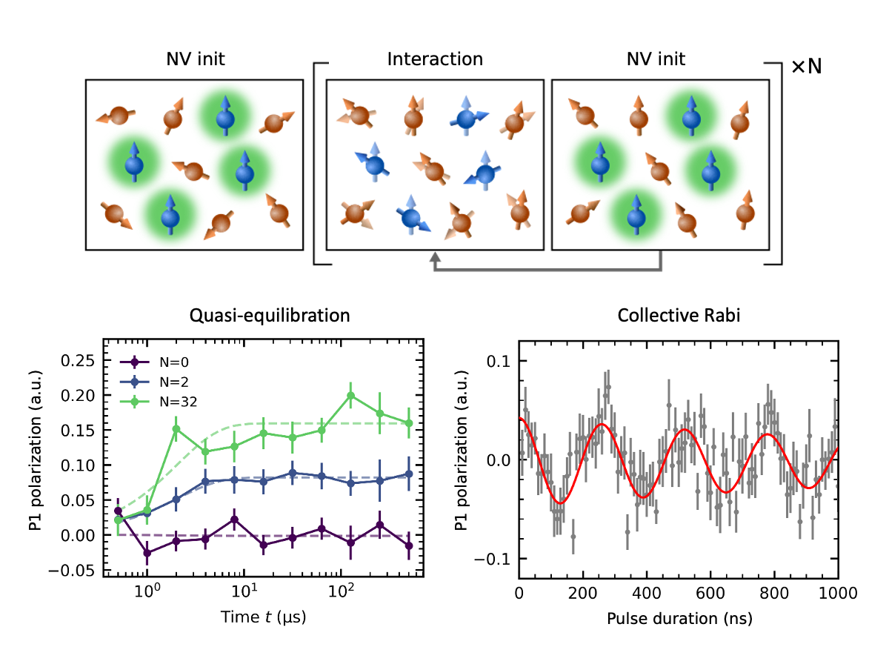
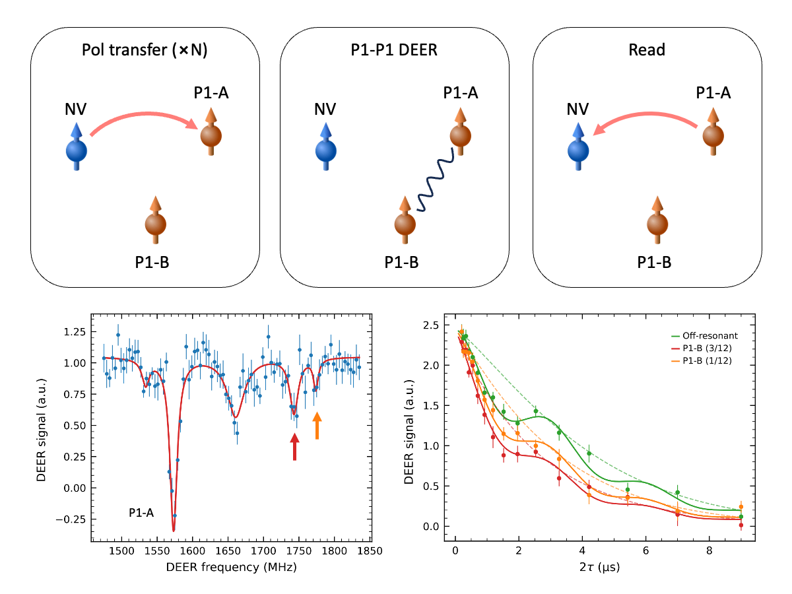
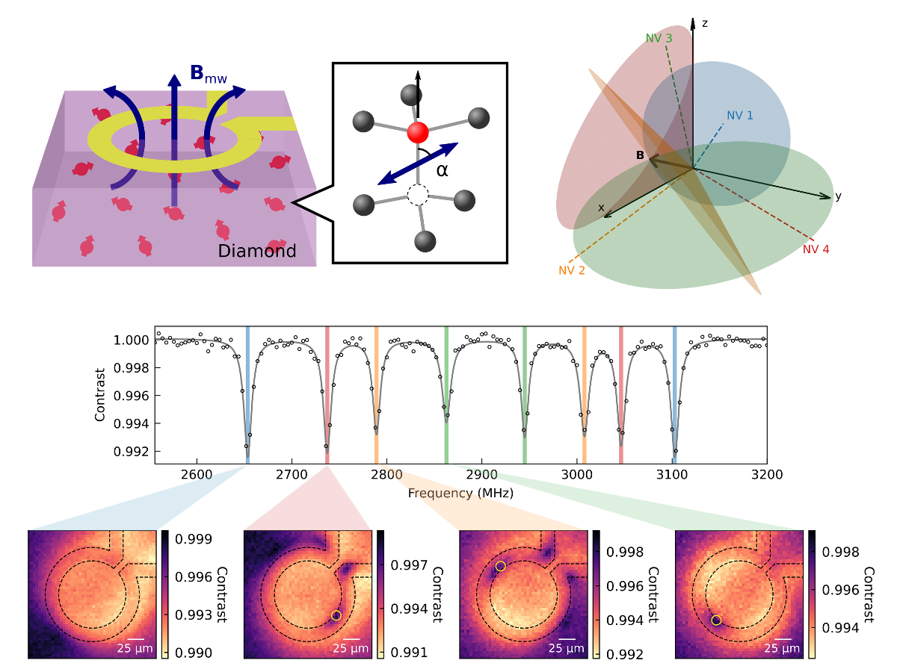
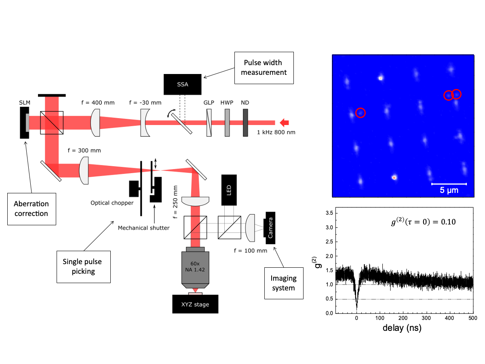

<section id="about" class="about-container">
    

        
    

    

        

            I am Taewoong Yoon, a Ph.D. candidate advised by <strong><a href="https://choigroup.snu.ac.kr" target="_blank">Prof.&nbsp;Hyunyong Choi</a></strong>
            in the Department of Physics and Astronomy at <strong>Seoul National University</strong>.
            I also work with <strong><a href="https://sites.google.com/view/pauleegroup" target="_blank">Dr.&nbsp;Junghyun Lee</a></strong>
            at the <strong>Korea Institute of Science and Technology (KIST)</strong>. I expect to complete my Ph.D. in February 2027 and am seeking a postdoctoral position.
        

        

            My research focuses on coherent control of <strong>solid-state spin defects</strong>, in particular
            nitrogen-vacancy (NV) and substitutional nitrogen (P1) centers in diamond, and on the interactions and
            polarization dynamics among these spin ensembles.
            I built my group's first NV measurement setup, from the confocal optics and microwave hardware
            to the control and data acquisition software, which served as the platform for my doctoral research.
        

    

</section>

<section id="research" class="research-section">
    <h2>Research</h2>

    

        

            
        

        

            <h3>Mesoscopic spin coherence in a disordered dark electron spin ensemble</h3>
            

                P1 centers are optically dark and lack a direct optical initialization pathway. By iteratively
                transferring polarization from optically initialized NV centers, I polarized the P1
                ensemble to 740 times its thermal-equilibrium value and characterized its collective
                coherent dynamics.
            

            

                <a href="https://doi.org/10.48550/arXiv.2602.17074" target="_blank">arXiv:2602.17074</a> (2026)
            

        

    

    

        

            
        

        

            <h3>Controlled polarization exchange between P1 subensembles</h3>
            

                I demonstrated controlled polarization transfer between spectrally resolved P1 subensembles by extending
                the NV&ndash;P1 protocols to interactions within the P1 ensemble.
            

        

    

    

        

            
        

        

            <h3>Vector magnetometry with NV ensembles</h3>
            

                NV centers in an ensemble are oriented along four crystallographic axes, and
                reconstructing a vector magnetic field requires assigning each resonance to its axis.
                I identified the axes from a spatially varying microwave field, which enables vector
                magnetometry without a calibrated bias field.
            

            

                <a href="https://doi.org/10.1063/5.0243162" target="_blank"><em>Applied Physics Letters</em> <strong>126</strong>, 144002 (2025)</a>
            

        

    

    

        

            
        

        

            <h3>Femtosecond laser writing of color centers</h3>
            

                I created site-controlled single color centers in diamond and hexagonal boron nitride,
                confirmed by photon antibunching, using a home-built single-pulse femtosecond
                laser-writing system with aberration correction.
            

        

    

</section>




<section id="publications" class="cv-section">
    <h2>Publications</h2>
    
    {{ publications | markdownify }}
</section>





